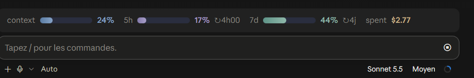

# claude-mods

A small collection of [Claude Code](https://claude.com/claude-code) mods, installable from one marketplace.

## Mods

| Mod | What it does | Preview |
| --- | --- | --- |
| [`usage-bars`](mods/usage-bars) | Rounded gradient bars for context, 5h and 7d usage, plus session spend, above the prompt. |  |

## Install

In a Claude Code terminal session:

```
/plugin install usage-bars --marketplace Nelahia/claude-mods
```

Answer `y` to add the marketplace, then pick the `user` scope. The mod is active right away, and in every session started afterwards, including the desktop app.

To browse every mod first: `/plugin marketplace add Nelahia/claude-mods`, then open `/plugin`.

## Layout

```
.claude-plugin/marketplace.json   the catalog: one entry per mod
mods/
  <mod-name>/
    .claude-plugin/plugin.json    manifest
    hooks/                        hooks module (register.tsx) and helpers
    types/                        state contract, when the mod keeps state
    README.md                     what it does, options, limits
```

## Adding a mod

1. Create `mods/<mod-name>/` with the layout above.
2. Add an entry to `.claude-plugin/marketplace.json`: `{ "name": "<mod-name>", "source": "./mods/<mod-name>" }`.
3. Check it with `claude plugin validate .`, then add a row to the table above.

## License

[MIT](LICENSE)
