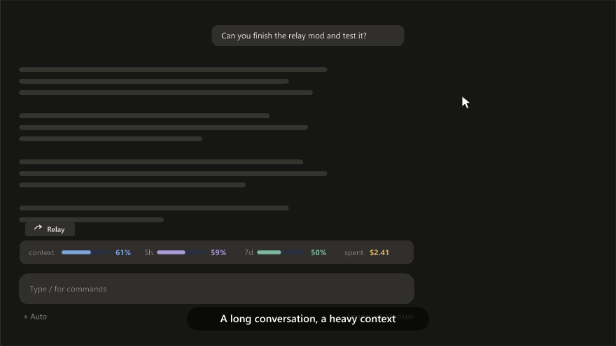
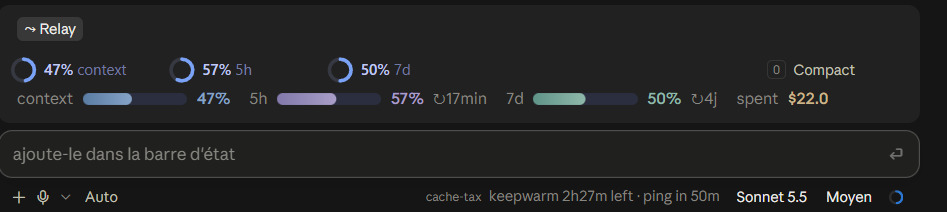
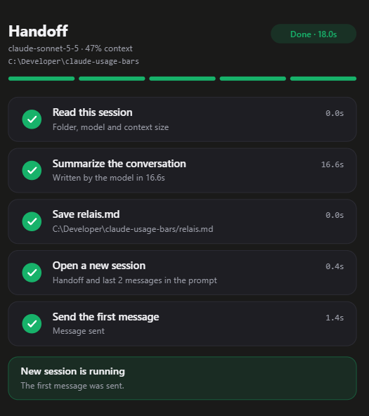

# context-relay

Hands a long conversation over to a fresh Claude Desktop session, in one click, when you choose.

## Install

In a Claude Code session:

```
/plugin install context-relay --marketplace Nelahia/claude-kit
```

Answer `y` to add the marketplace, then pick the `user` scope. Or from a terminal:

```
claude plugin marketplace add Nelahia/claude-kit
claude plugin install context-relay@nelahia-kit
```

Mods load when a conversation starts, so **open a new conversation** to see the **Relay** button above the prompt. Windows and the Claude Desktop app are required.





## Why

A long session gets slow, expensive and fuzzy: the context fills up, old details drown the useful ones, and `/compact` loses the thread. Starting over loses everything. **Relay keeps the thread and drops the weight.**

### Your context hits 80%, and you are mid-feature

You are halfway through a refactor. Instead of compacting and hoping, click **Relay**. A few seconds later a clean session opens that already knows:

- **Goal**: "split `register.tsx` into hooks and services".
- **Up next**: "extract `saveHandoff`, then run the tests".
- **Locked in**: "no `try/catch` per handler, one global error handler" (so it does not reopen the debate).
- **Suggested skills**: the ones worth invoking next.

You keep working at 5% context instead of 80%, and the 5h and 7d bars thank you.

### You stop on Friday, you resume on Monday

Relay is also a clean pause button. The summary is saved as `relais-<folder>.md`; the next session opens on it, with the end of your last two messages, so the open question is the first thing it sees. No "where were we?".

### You want a fresh start without re-explaining

Switch model, switch effort, or just escape a session that went down a wrong path. The new session gets the decisions, not the dead ends.

### Nothing sensitive travels

The summary points to specs, issues and commits instead of copying them. Secrets (API keys, tokens, `password=…`, private keys) and emails are masked in the summary and in the copied messages.

## How it works

1. Click **Relay** (or run `/context-relay`).
2. The model writes a summary under 2500 characters, in this order: Goal, Up next, Locked in, Suggested skills, Shipped.
3. It is saved in the OS temp folder.
4. A new session opens with the summary and the end of the last 2 messages already typed.
5. The first message is sent for you.



A side panel shows each step while it runs, and the time it took.

## Command

- `/context-relay`: run the handoff from the prompt.

## Option

- `openInFolder` (default false): open the new session in the same folder (the app asks to trust it, so it is slower).

## Limits

Windows only: the first message is sent with a PowerShell UI Automation script. The deep link carries at most about 7000 encoded characters: the summary is cut first (Shipped goes first), then the last messages.
